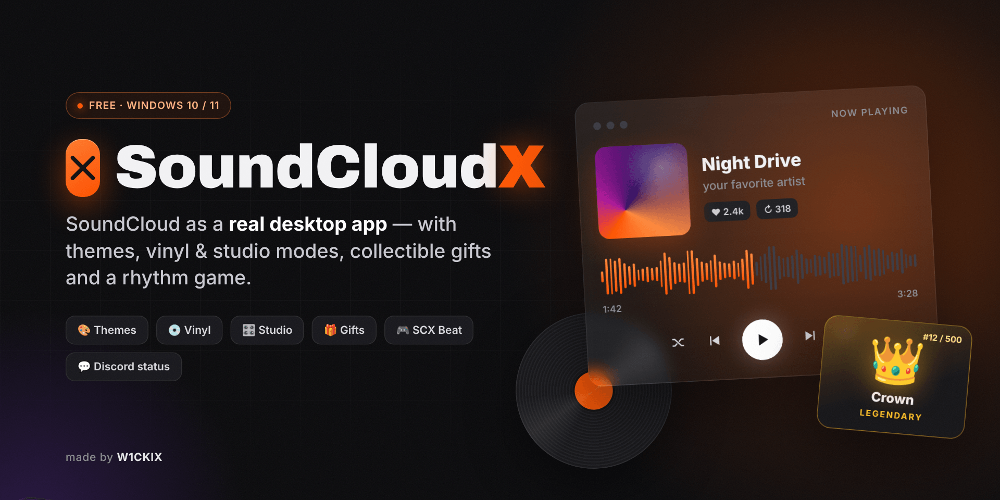
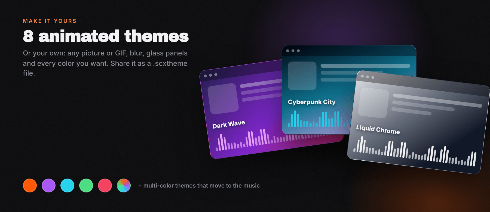
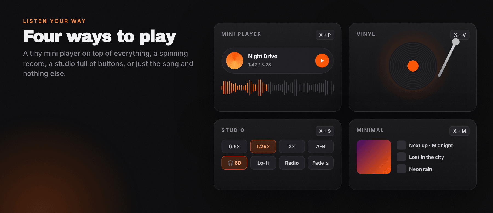
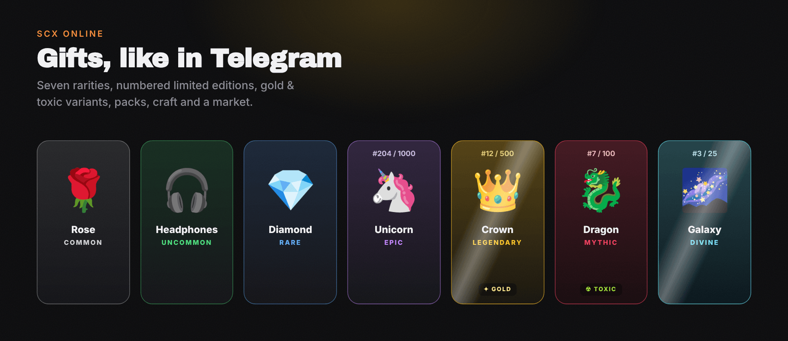
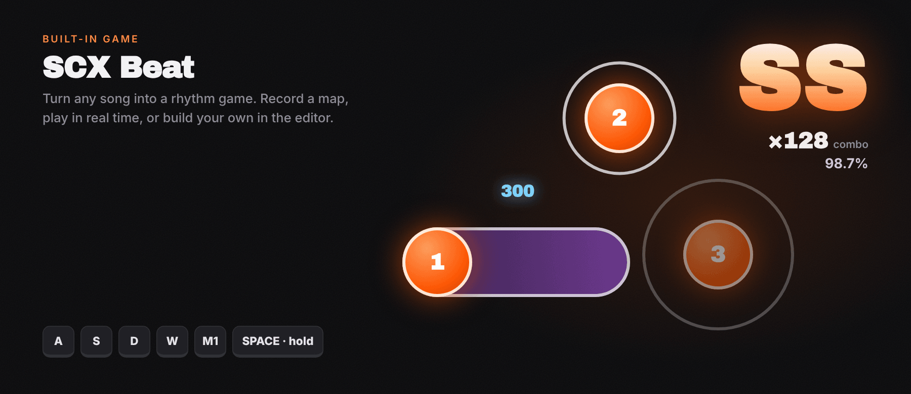

<p align="center">
  
</p>

<p align="center">
  <a href="../../releases/latest"></a>
  &nbsp;
  
  
</p>

<p align="center">
  <b>SoundCloud, but it finally feels like an app.</b><br>
  <sub>Themes · Vinyl & Studio modes · Collectible gifts · A rhythm game · Discord status</sub>
</p>

---

I love SoundCloud. I didn't love listening to it in a browser tab, between forty other tabs.
So I built **SoundCloudX** — your normal SoundCloud account, in its own window, with all the things I always wanted it to have.

You log in once. Everything you like, follow and listen to stays the same. SCX just makes it look and feel better — and adds a little world around it.

<br>



### Make it look like *your* SoundCloud

Pick one of **8 animated themes** — Dark Wave, Cyberpunk City, Y2K, Liquid Chrome, Space, Audio Visualizer, Rainy Window or Underground.
Or make your own: drop in any picture or GIF, blur it, darken it, put glass panels on top and choose every color yourself.
Happy with it? Save it as a `.scxtheme` file and send it to a friend.

Even the loading screen and SoundCloud's waveform follow your color. With Premium, the theme can **flow between several colors** — on its own, or to the beat.

<br>



### Four ways to listen

| | |
|---|---|
| 🎧 **Mini player** `X` `P` | A small player on top of everything else. Ball, Wave or Ultra mini. |
| 💿 **Vinyl** `X` `V` | The song spins on a record, the needle drops when it plays, the room pulses with the bass. |
| 🎛️ **Studio** `X` `S` | Every button: speed 0.5×–2×, A–B loop, hot cues, 8D audio, Lo-fi / Radio / Underwater, fades, tap tempo, skip intro, sleep timer. |
| ✨ **Minimal** `X` `M` | Just the cover, the song and what's next. Nothing else. |

On top of that: **SoundBoost** up to 300 % with a bass boost and a limiter, a **bass glow** around the screen, and **Wave / Ball** visualizers in any color.

<br>



### Gifts, like in Telegram

Join **SCX Online** and you get a profile — nick, frame, profile background, tags and up to 3 pinned gifts. People with SCX see it right on your SoundCloud page.

- **7 rarities** — from Common to Divine
- **Limited editions** with a number on every copy (`#12 / 500`)
- **Variants** — ✦ Gold, Silver, ☢ Toxic and more, with their own effects
- **Gift packs** you open for a surprise, **craft** 3 gifts into a better one
- **🎫 Tickets** hidden in songs — find one while listening
- **Market** — sell gifts to other people
- **★ Premium** — 100 gift places, −10 % in the Shop and a star next to your nick

You earn **coins** just by using SCX: listening, likes, reposts, comments and time in the app.

<br>



### SCX Beat — any song is a level

A rhythm game built right into the player.

- ● **Record** — listen once, SCX writes down every beat and gives you an exact map
- ⚡ **Real time** — play any song right now, the circles follow the beat live
- ✏️ **Make own** — a full map editor with snap to beat, HOLD notes and test play

Aim with the mouse, hit with `A` `S` `D` `W` `E` `Q` or `M1` / `M2`, hold `Space` for HOLD circles. Ranks from SS to D, and your score turns into coins.

<!--
  ADD YOUR OWN SCREENSHOTS HERE:
  1. put the pictures into the "assets" folder (screenshot-1.png, screenshot-2.png, …)
  2. remove this line and the two lines with the arrows around this block

<br>

### Screenshots

<p align="center">
  
  
</p>
-->

<br>

## And the small things

- 💬 **Discord status** — *Listening to SoundCloudX*, with the song, cover and time
- 📊 **Stats** — today, the last 7 days and all time: songs, hours, top artists
- 👥 See who's in SCX right now and what they play — **Listen too** in one click
- 🔑 **Recovery code** — move your profile, coins and gifts to a new PC
- ⬇️ **Auto-update** — new versions install themselves
- 🖥️ Full screen like F11, its own top bar, smooth minimize and restore

<br>

## ⌨️ Hotkeys

| Keys | |
|---|---|
| `X` + `P` | Mini player |
| `X` + `O` | Show / hide the SCX menu |
| `X` + `M` · `V` · `S` | Minimal · Vinyl · Studio |
| `Ctrl` + `Alt` + `P` / `O` | Same, from anywhere in Windows |
| `F11` | Full screen |
| `Esc` | Close the menu / stop the game |

<br>

## 📥 Install

1. Go to **[Releases](../../releases/latest)**
2. Download **`SoundCloudX Setup.exe`** (installs + updates itself) or **`SoundCloudX-portable.exe`** (no install)
3. Windows says *"Windows protected your PC"*? → **More info → Run anyway**.
   That only means the app isn't code-signed — signing costs a few hundred euros a year.

<details>
<summary><b>Build it yourself</b></summary>

<br>

You need [Node.js](https://nodejs.org) (LTS).

```
npm install
npm run build
```

Or just double-click **build.bat**. The `.exe` files appear in `dist/`.

**Own server (optional).** SCX Online runs on [Supabase](https://supabase.com) — the free plan is enough.
Run these once in *Supabase → SQL Editor*, in this order:

`supabase-v1.7.sql` → `v1.8` → `v1.9` → `v2.0` → `v2.1` → `v2.2` → `v2.3` → `v2.6` → `v2.7` → `v2.8` → `v2.9`

</details>

<br>

## 🆕 What's new

**v2.8.1** — Studio fixes: buttons light up right away, fades always work, tap tempo shows the count, and Effects tell you if they reach the sound.

**v2.8** — ★ Multi-color themes (Flow, Jump, Plasma — on their own or to the music) · more Studio: Underwater / Radio / Lo-fi, 8D, balance, fades, tap tempo, skip intro · ticket show / animation switches · packs give variants only with a ticket · craft never gives limited gifts · Discord server banner, Advanced Discord settings for Premium

<details>
<summary><b>Older versions</b></summary>

<br>

**v2.7** — Auto-update from GitHub · variants with up to 4 colors and 10 effects · Shop sorting & filters · Original price on the Market · loading screen in your theme color

**v2.6** — Fixed: v2.5 stuck on the loading screen · send gifts and coins anonymously · gift codes in SoundCloud messages turn into gift cards

**v2.5** — Gift variants (Gold, Silver, Toxic) · craft · tickets hidden in songs · moving backgrounds and waveform in your color · fold My gifts

**v2.4** — Studio mode · picture frames on SoundCloud profiles full size again

**v2.3** — Vinyl mode · My style · Premium CSS · gift numbers on hover · restart button

**v2.2** — New Shop · Market · Premium · promo codes · Minimal mode

**v2.1** — Gift packs · pass gifts on · recovery code · nicks without upper / lower case

**v2.0** — Gifts with 7 rarities · send coins, gifts, tags and frames · pin 3 gifts · picture frames

**v1.9** — Frames and profile backgrounds · SCX Beat: Record, Real time, Make own · menu on the left

</details>

<br>

## 🔒 Privacy

SCX Online only shares your nick, profile picture, what you're playing, your coins and stats. No e-mail, no password — your SoundCloud login never leaves your PC.

<br>

---

<p align="center">
  <sub>Made with 🧡 by <b>W1CKIX</b><br>
  Not affiliated with SoundCloud. SoundCloud is a trademark of SoundCloud Global Limited.<br>
  Downloads only work for tracks where the artist allowed it.</sub>
</p>
