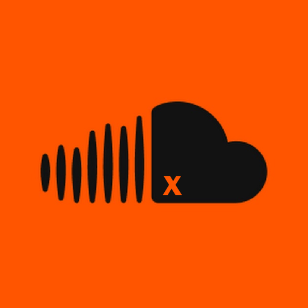

<p align="center">
  
</p>

<h1 align="center">SoundCloudX</h1>

<p align="center">
  <b>SoundCloud as a real Windows app — themes, visualizers, a mini player, a rhythm game, gifts and Discord status.</b><br>
  <sub>SCX By W1CKIX · v2.0</sub>
</p>

<p align="center">
  <a href="../../releases/latest"></a>
  
  
</p>

---

## 🆕 What's new in v2.0

- 🎁 **Gifts like in Telegram** — emoji or picture gifts with 7 rarities, limited editions with numbers (#12)
- 🪙 **Send coins, gifts, tags and frames** to other SCX users, with a message
- 📌 **Pin up to 3 gifts** on your profile — visible in SCX and on your SoundCloud page
- 🌸 **Picture frames** — a picture / GIF behind or over your profile picture, like Discord avatar decorations

<details>
<summary><b>v1.9</b></summary>

- ⭕ Frames around your profile picture and 🖼️ profile backgrounds (pictures / GIFs from the Shop)
- 🎮 SCX Beat: 3 modes — **Record**, **Real time**, **Make own** (map editor)
- HOLD circles on `Space`, game coins = score ÷ 10
- Menu sections on the left
</details>

---

## ✨ Features

### 🖥️ App
- Opens soundcloud.com as its own app, full screen like F11
- Own top bar (hover the top edge): **SoundCloudX menu**, minimize, small window, close
- Loading screen, smooth minimize / restore animations
- Your SoundCloud login is remembered

### 🎨 Themes
- 8 animated themes: 🌌 Dark Wave · 🌃 Cyberpunk City · 🖤 Y2K · 🌊 Liquid Chrome · 🌠 Space / Saturn · 🎵 Audio Visualizer · 🌧️ Rainy Window · 🕸️ Underground
- Background: song cover, your own picture / **GIF** or a theme — blur, darkness, glass panels
- Your own colors for text, accents, sliders and the menu
- **Save my theme / Load theme** — share `.scxtheme` files

### 🔊 Visual & Sound
- Visualizers: **Wave** and **Ball**, any color
- **Bass glow** — the screen edges light up on every bass hit
- **SoundBoost** — up to 300% volume and bass boost (with a limiter)
- Repost / like animations, **Next up** card

### 🎧 Mini player
- Classic · Ball · Wave · Ultra mini
- Sound background that pulses to the music
- Next up, −5s / +5s, volume

### 🎮 SCX Beat — rhythm game
| Mode | How it works |
|---|---|
| ● **Record** | Listen to a song once → SCX writes down every beat → play an exact map |
| ⚡ **Real time** | Play any song right now, circles follow the beat live |
| ✏️ **Make own** | Map editor: rewind the song, tap points, hold `Space` for HOLD circles, snap to beat, undo, test play |

- Tap circles: aim with the mouse + `A` `S` `D` `W` `E` `Q` or `M1` / `M2` · HOLD circles: `Space`
- Easy / Normal / Hard, combo, accuracy, ranks SS–D, best scores
- Share maps as `.scxmap` files

### 🌐 SCX Online
- Profile: nick, SoundCloud picture and 🔗 link, coins, stats, frame, background, pinned gifts
- Who is in SCX right now and what they play — **Listen too** in one click
- Follow people, leaderboards (coins and SCX Beat), search
- **SCX badge on SoundCloud profiles** of SCX users (seen by everyone using SCX)

### 🎁 Gifts
| Rarity | Color |
|---|---|
| Common | ⚪ white |
| Uncommon | 🟢 green |
| Rare | 🔵 blue |
| Epic | 🟣 purple |
| Legendary | 🟠 gold |
| Mythic | 🔴 red / pink |
| Divine | 🩵 sky blue, shimmering |

- Buy a gift for a friend or for yourself, add a message
- Limited gifts run out (`459 / 500 left`) and every copy has its number
- Pin up to **3** on your profile

### 🛒 Shop
- **Gifts**, **tags**, **frames** (rings or pictures / GIFs like Discord), **themes**, **pictures** and **GIFs**
- Pictures / GIFs as screen, menu or **profile background**

### 🪙 Coins
- Song +50 · Like +50 · Repost +100 · Comment +250 · Follow +500 · SCX Beat score ÷ 10
- Time in SCX: 1h +500 · 2h +1500 · 3h +2500 · 4h +3500 · 5h +5000 · then 5000 + hours × 200

### 📊 Stats
- Today: songs, time in SCX, listening time, likes, reposts, top artists
- Last 7 days and all time

### 💬 Discord
- Rich Presence: *Listening to SoundCloudX*, song, cover, time — just switch it on

---

## ⌨️ Hotkeys

| Keys | Action |
|---|---|
| `X` + `P` | Mini player |
| `X` + `O` | Show / hide SoundCloudX |
| `Ctrl` + `Alt` + `P` / `O` | Same, anywhere in Windows |
| `F11` | Full screen |
| `Esc` | Close the menu / stop the game |

---

## 📥 Install

1. Open **[Releases](../../releases/latest)**
2. Download **SoundCloudX-portable.exe** (no install) or **SoundCloudX Setup.exe** (installer)
3. If Windows says *"Windows protected your PC"* → **More info → Run anyway** (the app is not code-signed)

## 🛠 Build it yourself

Needs [Node.js](https://nodejs.org) (LTS).

```
npm install
npm run build
```

or double-click **build.bat**. The `.exe` files appear in `dist/`.

## 🗄️ Own server (optional)

SCX Online runs on [Supabase](https://supabase.com) (free plan is enough).
Run these once in **Supabase → SQL Editor**, in this order:

`supabase-v1.7.sql` → `supabase-v1.8.sql` → `supabase-v1.9.sql` → `supabase-v2.0.sql`

---

## ℹ️ Notes

- Download only works for tracks where the artist allowed downloads (SoundCloud's own *Download file*).
- Only your nick, picture, what you play, coins and stats are shared in SCX Online — no e-mail, no password.
- Not affiliated with SoundCloud. SoundCloud is a trademark of SoundCloud Global Limited.

<p align="center"><sub>Made with 🧡 by W1CKIX</sub></p>
